## Diagrams Index

| # | Scenario | Services |
|---|---|---|
| 1 | User Registration & Workspace Setup | Auth, Workspace, Email |
| 2 | Platform Connector OAuth | Connector, Platform API, Webhook |
| 3 | AI Asset Generation (standard) | Asset, AI Gate, Provider, Credits |
| 4 | AI Asset Generation (failover) | Asset, Circuit Breaker, Provider A→B |
| 5 | Publish to Platform | Publish, Capability Check, Platform API |
| 6 | Order Ingestion | Webhook, Order, Inventory, Notification |
| 7 | Live Commerce Session | Live, Cue, Comment, Offer Pin |
| 8 | Reconciliation Flow | Settlement, Reconciliation, Proof Bundle |
| 9 | Workflow Trigger & Execute | Event, Workflow Engine, Action, Audit |
| 10 | Credit Reservation & Deduction | Credits, Generation Job, Provider |
| 11 | Remix Pipeline | Remix, ASR, LLM, Video Gen, Originality |
| 12 | Link-to-Video | LTV Service, Scraper, Product Data, Video |
| 13 | Asset Repurpose (1→50) | Repurpose, Clip Factory, Queue, Batch |

# B2 — Sequence Diagrams (Critical Flows)

> **Upstream**: PRD v3.1, Product Freeze, All Detail Design Packs
> **Format**: Mermaid sequence diagrams for top 15 critical flows

---

## 1. Trend → Idea → Script → Publish (Core Loop)

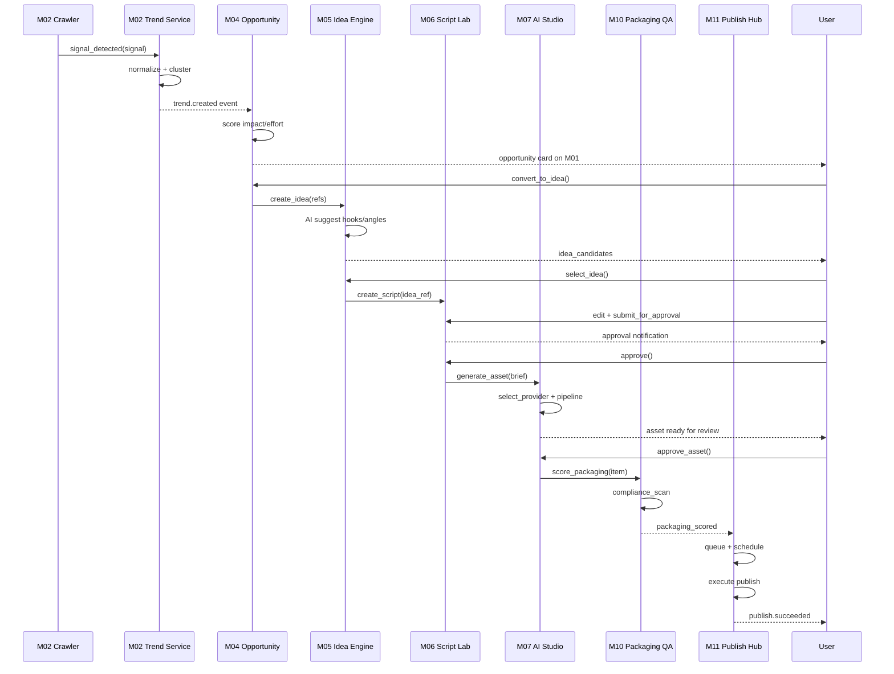

---

## 2. AI Video Generation Pipeline

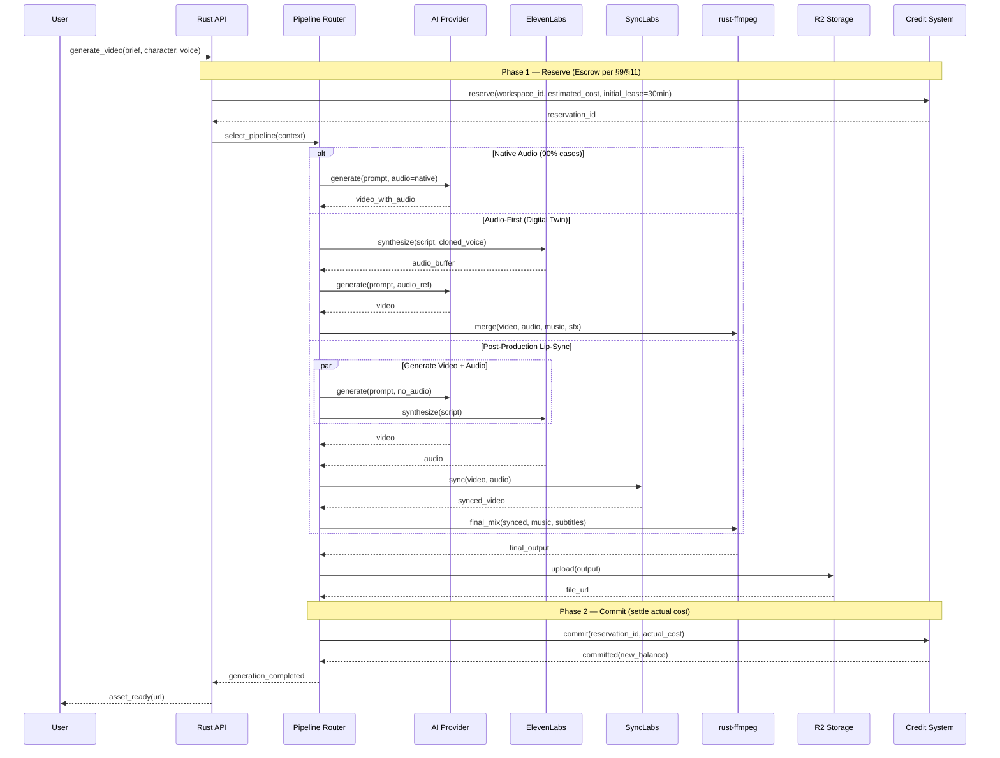

---

## 3. Publish Flow (with Capability Check)

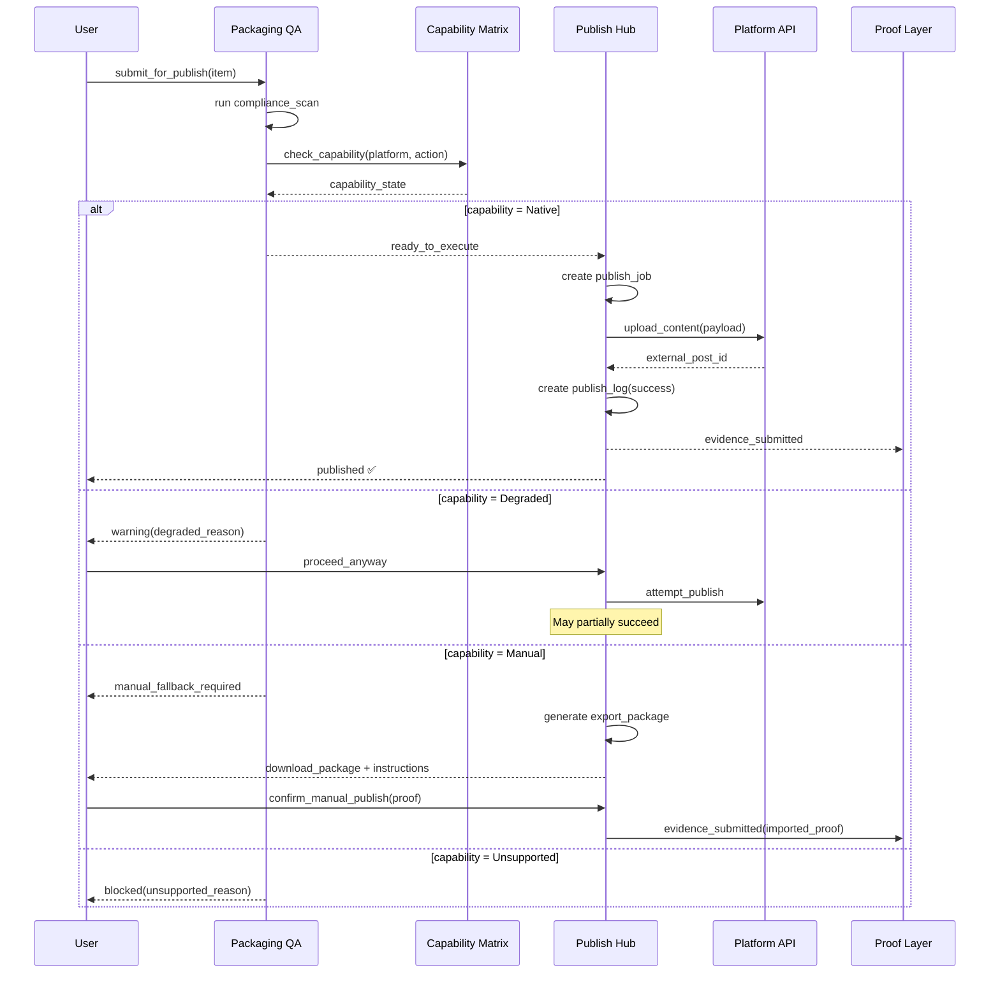

---

## 4. Order Import & Profit Calculation

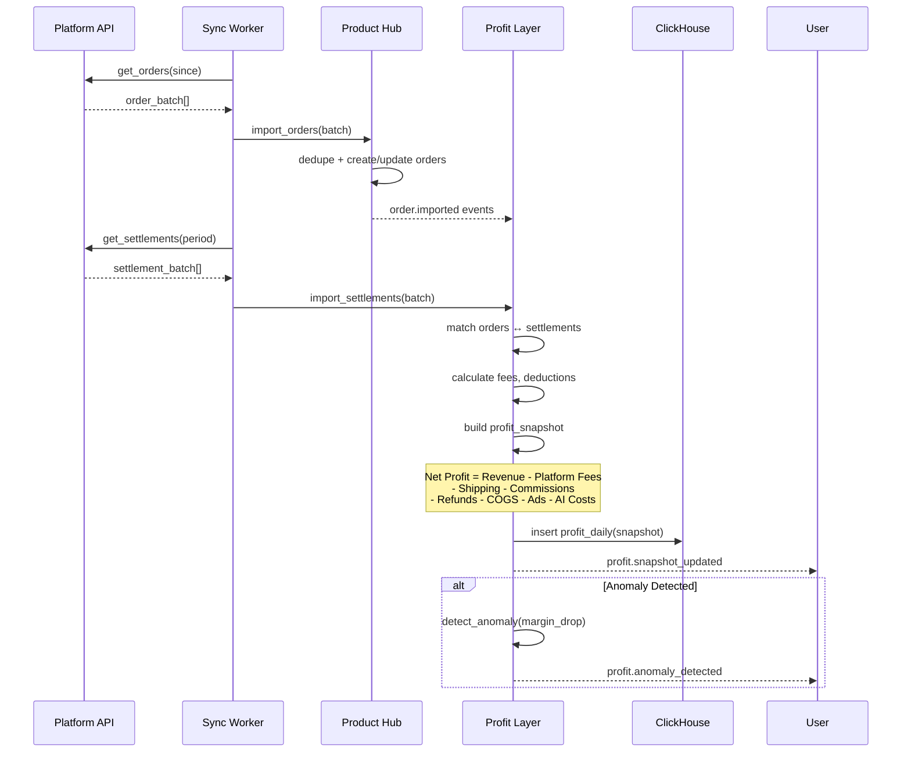

---

## 5. Thread → Commerce Conversion

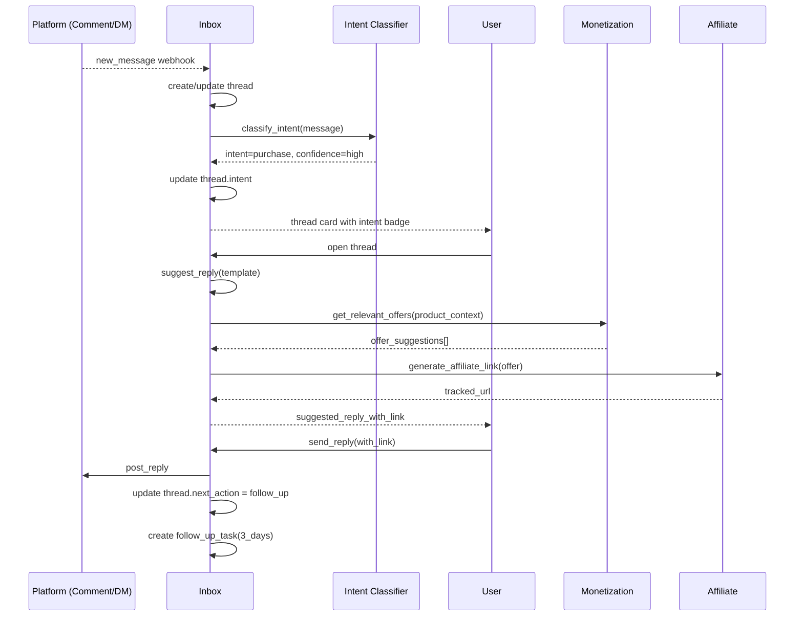

---

## 6. Workflow Execution (Activepieces)

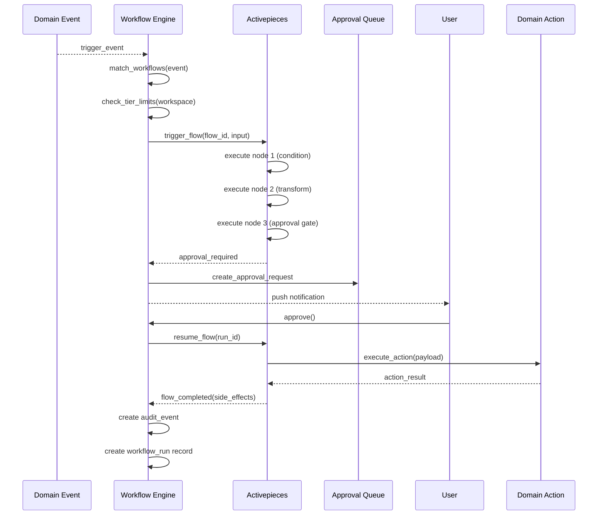

---

## 7. Authentication Flow (Clerk + Rust)

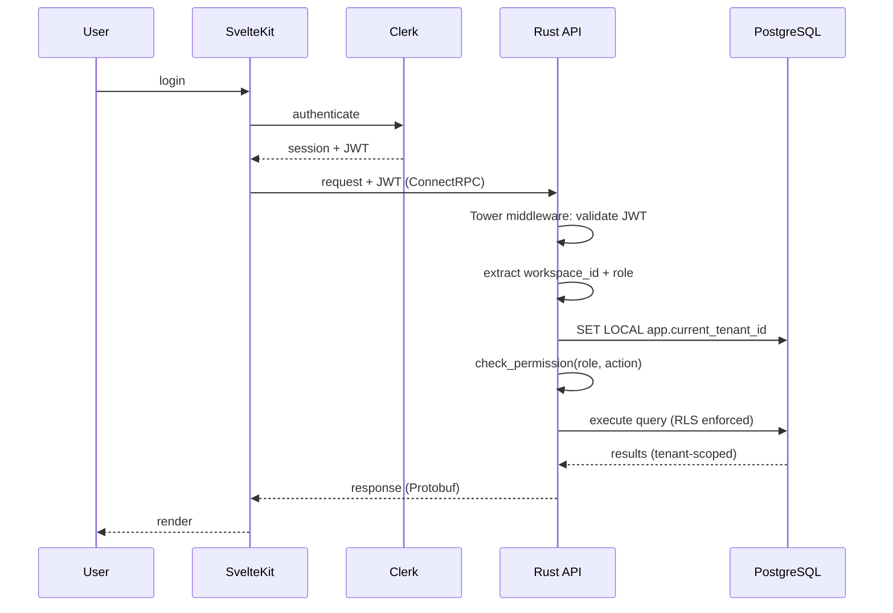

---

## 8. Morning Brief Generation (§35)

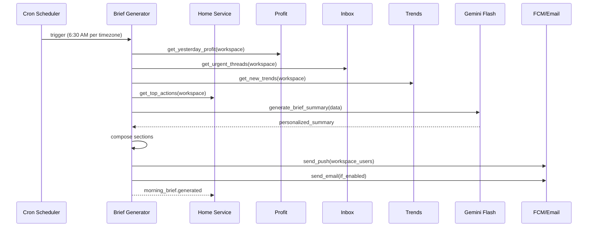

---

## 9. AI Credit Check and Execution

All AI flows use the durable state machine in [Credit accounting](../04_contracts/credit_accounting_contract.md). §11 shows the transaction boundaries; cache is a projection and never authorizes spend. Plan/role/object gates run before quote/hold.

---

## 10. AI Remix Pipeline (3-Phase — Audit v5 M5)

> **Ref**: Pack 04 §9.5, AI Remix Studio contract

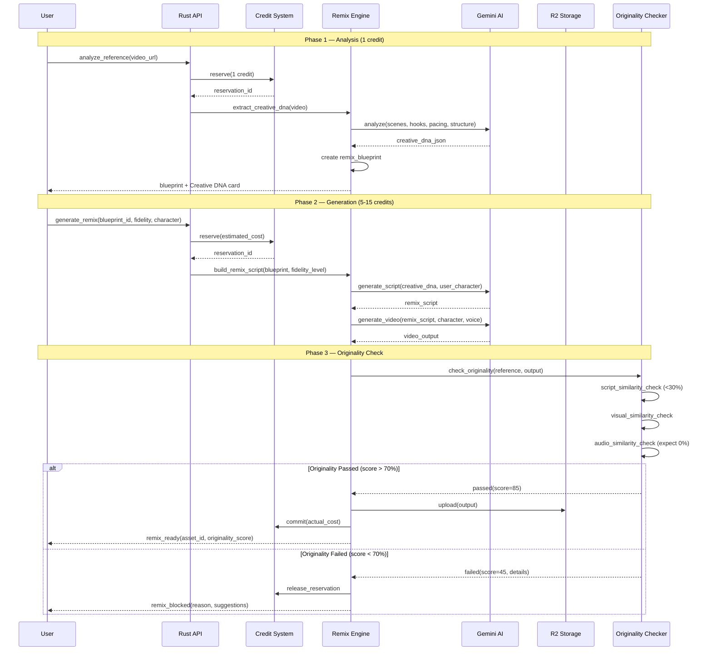

---

## 11. Durable Credit Reservation

```mermaid
sequenceDiagram
    participant User
    participant API
    participant DB as PostgreSQL
    participant Worker
    participant Provider
    User->>API: Confirm quote_id + confirmed_credits + idempotency_key
    API->>DB: BEGIN; lock workspace; validate quote; allocate lots
    API->>DB: INSERT reservation held + allocations + outbox; COMMIT
    API-->>User: Reservation/job identity
    Worker->>DB: Claim event; held to in_flight; persist external_effect
    Worker->>Provider: Submit with stable provider operation identity
    alt Usable output
        Provider-->>Worker: Result + measured units
        Worker->>DB: BEGIN; lock; conditional commit; append debit; release remainder; inbox + outbox; COMMIT
    else Definite failure or cancellation
        Worker->>DB: Conditional release exactly once; audit + outbox
    else Unknown result or worker restart
        Worker->>DB: Mark reconciling; retain hold; probe/status recovery
    end
    Note over DB: Sweeper expires only unsubmitted held reservations after 30 minutes
    Note over DB: Late callbacks and duplicate events cannot debit a terminal reservation
```

The complete transitions, source-lot expiry, five-reservation cap and restart fixtures are owned by [Credit accounting](../04_contracts/credit_accounting_contract.md).

---

## 12. Link-to-Video Pipeline (Audit v5 M5)

> **Ref**: Pack 04 §9.9 — Scrape product URL → Generate sales script → Create video

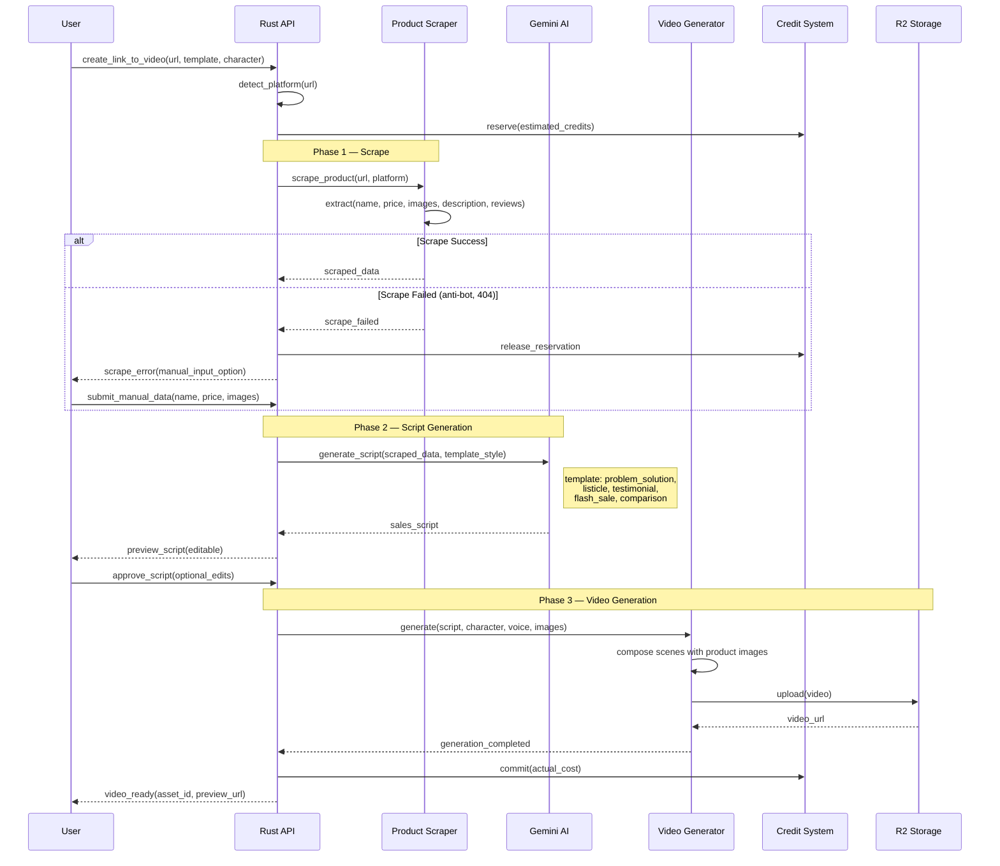

---

## 13. Content Repurpose Pipeline (1 → 50+) (Audit v5 M5)

> **Ref**: PRD §36, Pack 04 §9.13 — One video generates 50+ content pieces across formats.

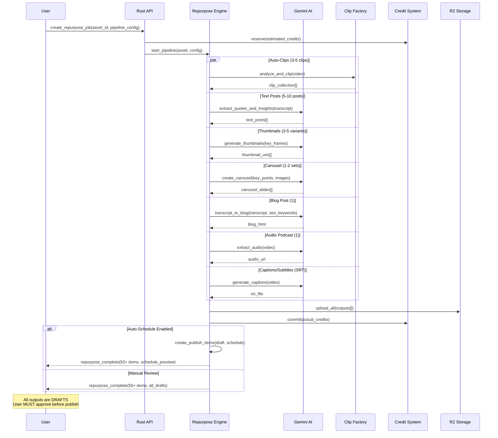

---

These 13 diagrams cover all critical and extended flows. The complete set provides implementation-ready sequence guidance for core system operations, AI production pipelines, commerce lifecycle, and credit management.

