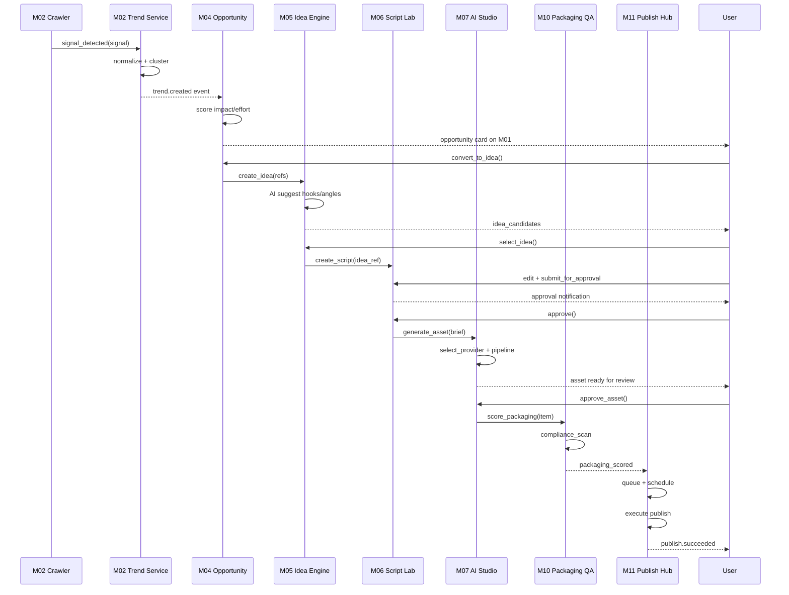
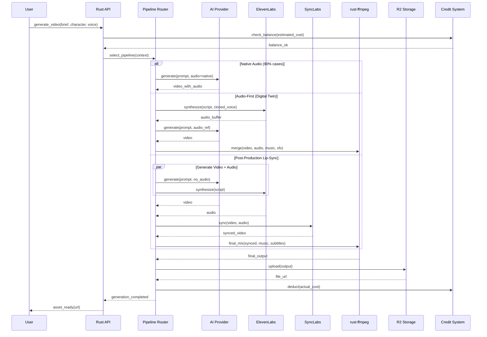
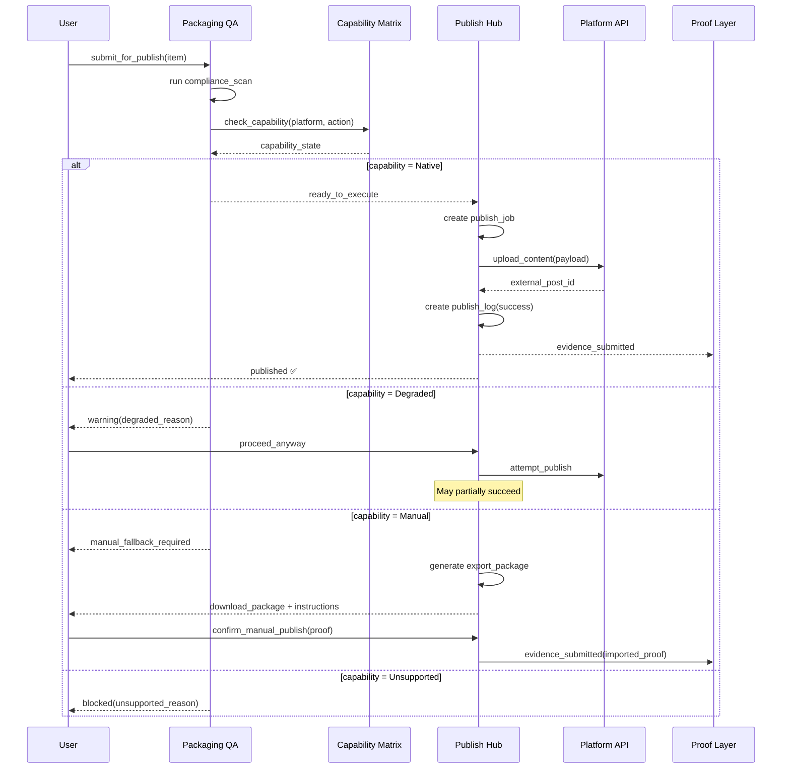
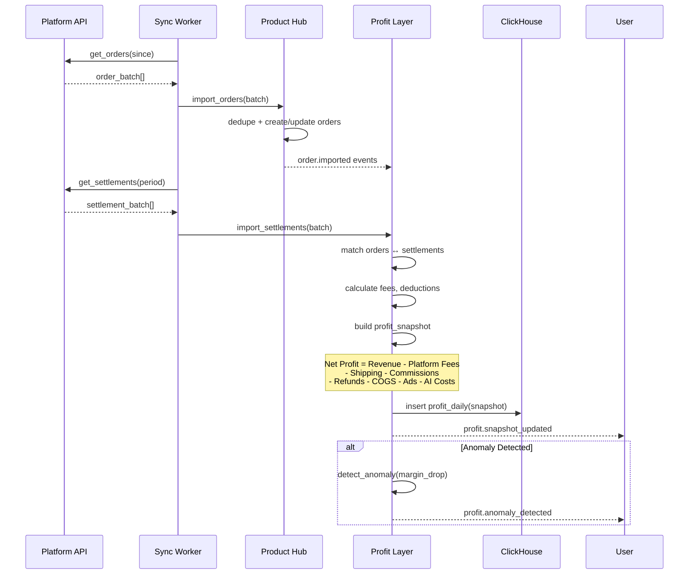
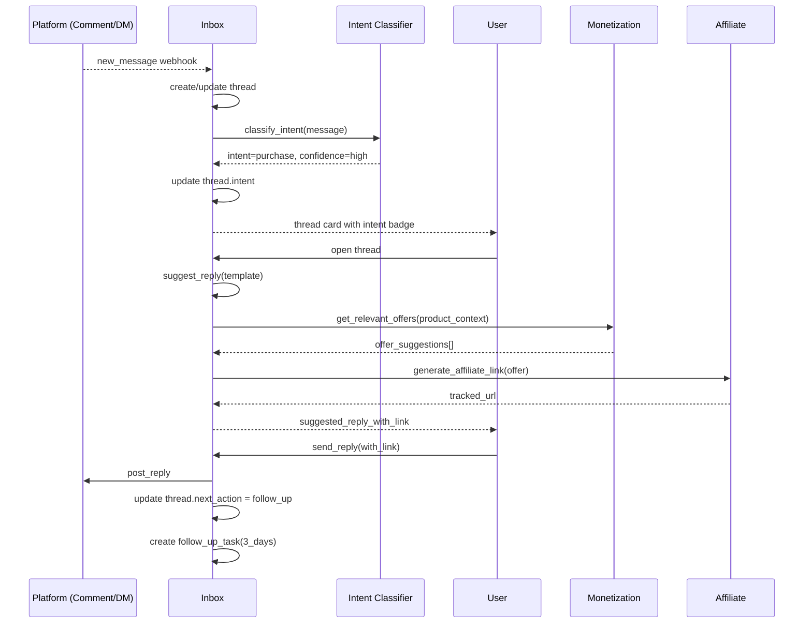
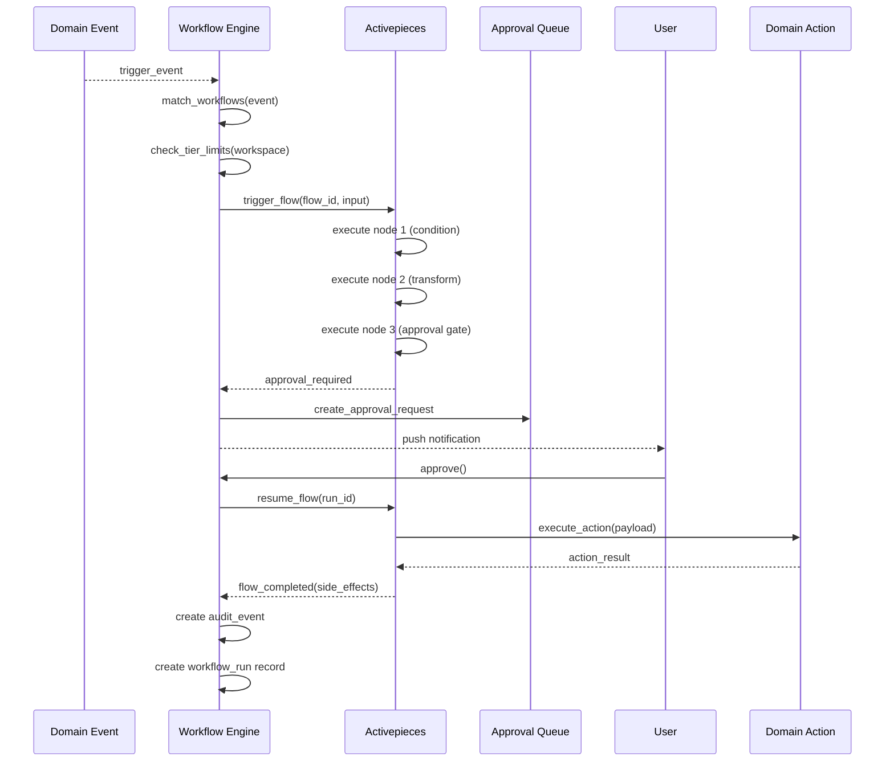
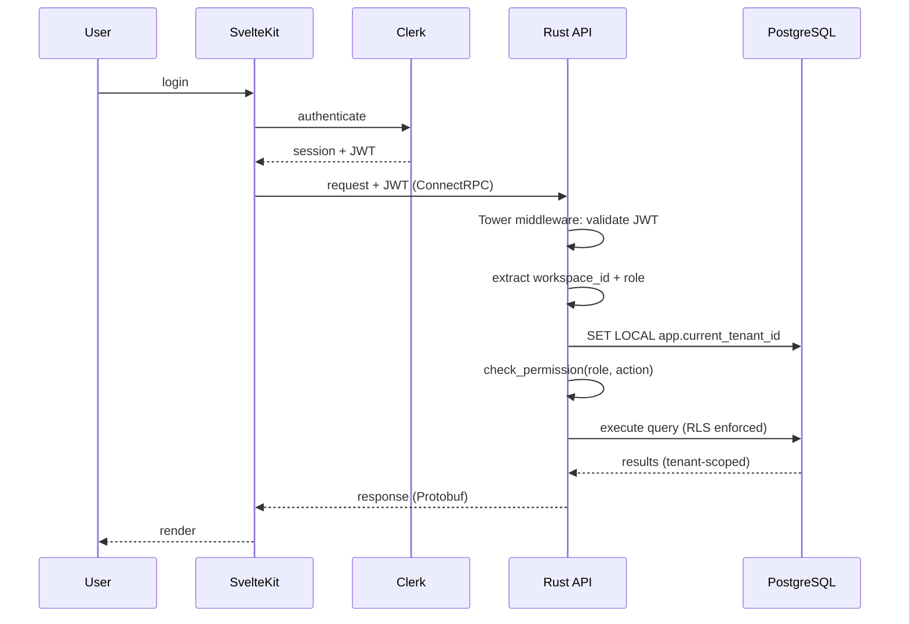
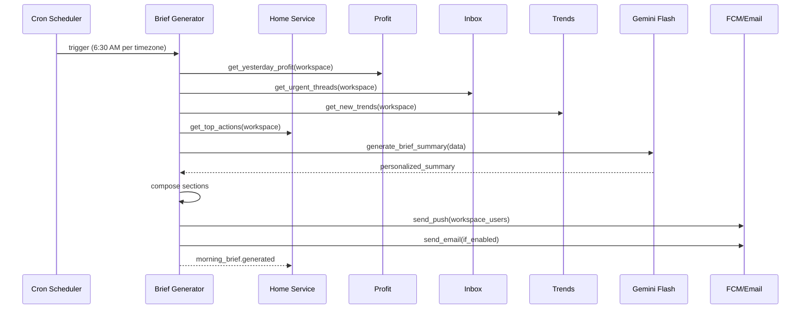
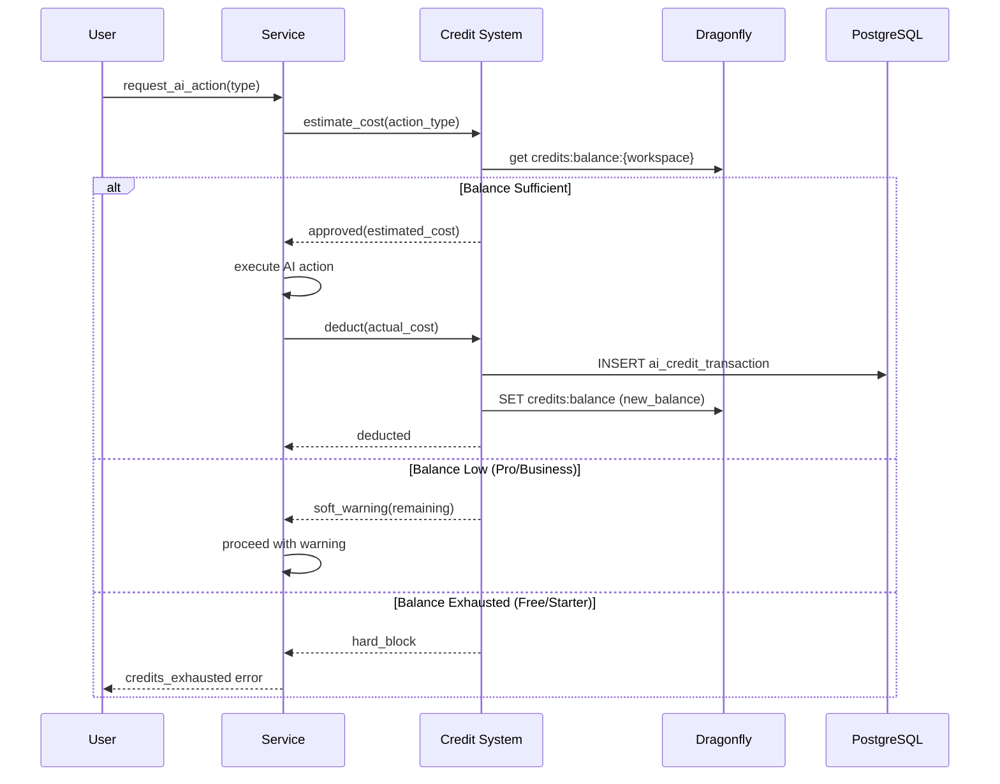

# B2 — Sequence Diagrams (Critical Flows)

> **Upstream**: PRD v3.1, Product Freeze, All Detail Design Packs
> **Format**: Mermaid sequence diagrams for top 15 critical flows

---

## 1. Trend → Idea → Script → Publish (Core Loop)

---

## 2. AI Video Generation Pipeline

---

## 3. Publish Flow (with Capability Check)

---

## 4. Order Import & Profit Calculation

---

## 5. Thread → Commerce Conversion

---

## 6. Workflow Execution (Activepieces)

---

## 7. Authentication Flow (Clerk + Rust)

---

## 8. Morning Brief Generation (§35)

---

## 9. AI Credit Check & Deduction

These 9 diagrams cover the most critical flows. Additional flows (Live Commerce, Seeding Pipeline, Referral, Dunning, Content Repurpose) follow similar patterns documented in the upstream packs.
